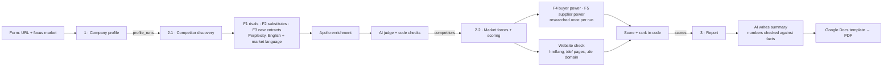

# Competitor Discovery Agent

An n8n pipeline that maps a company's competitors from one input: its website.
It uses Porter's Five Forces, checks every claim against a source, scores each competitor in code, and writes a PDF report.

**Input:** a company URL, a focus market (for example DACH) and one option: include global players or not.
**Output:** a scored competitor report (Google Docs → PDF) and all data in Supabase.

---

## Why this exists

Most AI competitor lists are hard to trust. The model guesses, mixes up companies with similar names, and gives different answers on every run.
This pipeline follows one rule: **the AI collects and classifies, code decides.**
- Every profile field and every competitor needs a word-for-word quote. Code checks the quote against the source text.
- The judge sees real company data (enrichment) before it decides.
- Scores, tiers and market labels are computed in code, so every number can be explained.
- Market research runs once per run, so a re-run gives the same scores.

---

## Architecture



| Stage | Workflow file | What it does |
|---|---|---|
| 1 | `1-company-profile.json` | Reads the company's own website (Perplexity, Apify as fallback). Claude extracts a profile; code keeps only fields with a verified quote. |
| 2.1 | `2.1-competitor-discovery.json` | Searches rivals, substitutes and new entrants in English and the market language, with a country filter. Enriches each company with Apollo. An AI judge rates each force; code enforces the rules. |
| 2.2 | `2.2-market-forces-and-scoring.json` | Rates buyer and supplier power with cited sources, checks each competitor's website for a market version, and scores and ranks everyone. |
| 3 | `3-report.json` | Builds the report data, lets Claude write the narrative, removes any sentence with a number not found in the data, fills the Google Docs template and exports a PDF. |

---

## Guardrails (rules in code, not in prompts)

- **Quote check:** profile fields and judge verdicts must quote the source word for word. Unproven items are dropped.
- **Judge after enrichment:** the judge sees Apollo data (description, size, HQ, keywords), not just a search snippet.
- **Rivalry vs. substitute:** rivalry needs the same main job. "Partly the same job" becomes a substitute.
- **Fail-safe segments:** "different customer segment" only counts with a quote and a known company size of the analysed company. Unknown data is never penalised.
- **Cut-off answers:** an unreadable judge answer is marked `JUDGE FAILED` and not saved as a verdict.
- **Reproducible forces:** buyer and supplier power are researched once per `run_id` and reused.
- **Overall force rating in code:** the AI rates each driver with a source; code computes the overall rating.
- **Number check in the report:** every number in the AI text must appear in the data, or the sentence is removed.

---

## Scoring

```
score = 100 × C × (0.6 × R + 0.2 × S + 0.2 × M) × platform × market
```

| Part | Meaning |
|---|---|
| **R** relevance | Best force weight (rivalry 1.0, substitute 0.8, new entrant 0.6; adjusted by buyer power), multiplied by job focus (core 1.0, major module 0.8, side feature 0.5) |
| **S** size | Employees and funding (log scale). Unknown size is left out, not counted as small. |
| **M** momentum | Headcount growth (12 months) and funding recency, multiplied by job focus |
| **C** confidence | verified 1.0, unsure 0.7 |
| **platform** | ×1.1 for TMS/ERP/visibility platforms when supplier power is medium or high |
| **market** | ×0.8 when the HQ is known, outside the focus market, and no market signal was found |

**Tiers:** 70+ primary threat · 50–69 watch · below 50 peripheral. A clearly different customer segment is capped at Watch.

**Market presence:** `local` (HQ in the market) · `active` (market domain, hreflang tag, /de/ pages or market-language pages) · `none` (known HQ elsewhere, no signal) · `unknown` (no company data, no discount).

---

## Setup

1. **Supabase:** create a project and run `supabase/schema.sql` in the SQL editor.
2. **n8n credentials:** Supabase (URL + service_role key), Anthropic, Perplexity, Apollo, Apify, Google Drive, Google Docs.
3. **Import the workflows** in this order: 3, 2.2, 2.1, 1. Then:
   - Replace `REPLACE_WITH_STAGE_*_WORKFLOW_ID` in the "Call" nodes with the IDs of your imported workflows.
   - Assign your credentials to every node marked `REPLACE`.
   - **Publish** stages 2.1, 2.2 and 3. Sub-workflows called from other sub-workflows must be published.
4. **Report template:** upload `template/report-template.docx` to Google Drive, open it as a Google Doc, and put its ID into the "Copy template" node (`REPLACE_WITH_GOOGLE_DOCS_TEMPLATE_ID`).
5. **Run:** open the form in stage 1, enter a URL and a focus market.

**Cost per run (approximate):** about 40 Apollo credits, about 15–20 Perplexity searches and a few Claude calls. Re-running stages 2.2 or 3 for the same `run_id` uses no Apollo or Perplexity credits.

---

## Case study (anonymised)

Tested on a Berlin SaaS company in transportation spend management, with focus market DACH:
- 40 competitors found and scored, with 1 primary threat and 8 on the watch list.
- The DACH HQ share rose from 7% to 41% after adding market-language searches and the market filter.
- 13 global players were separated into their own section instead of crowding the DACH list.

---

## Known limitations

- **Rivalry is classified too strictly.** Some pure freight-audit vendors end up as substitutes instead of direct rivals.
- **Size pulls large platforms up.** A big TMS with an audit module can outrank a small company doing exactly the same job.
- **Missing domains.** When search finds a company without a website, Apollo can only match by name, and the code rejects wrong matches. These companies stay without HQ and size data.
- **Apollo errors are not caught yet.** An out-of-credit error looks like "no match". The run should stop instead.
- **The research prompts for buyer and supplier power are tuned for logistics software.** Other industries need adjusted questions.
- **Snapshot only.** There is no "what changed since last month" view yet.

**Next:** company cache (pay for each company once), waterfall enrichment (Impressum check, second data source), a stricter rivalry rule, and a monthly change report.

---

Built by Aria Irani · [LinkedIn](https://www.linkedin.com/in/aria-irani-7a9563261) · [GitHub](https://github.com/ARIA994)
